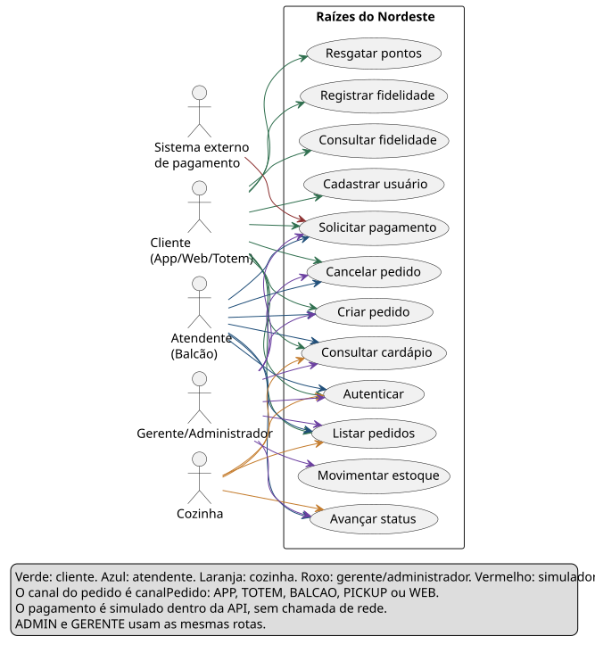
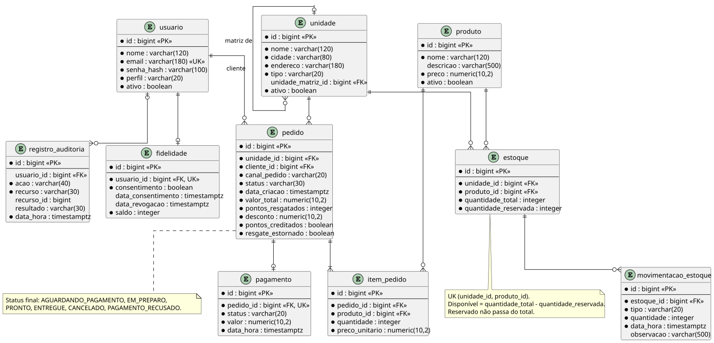
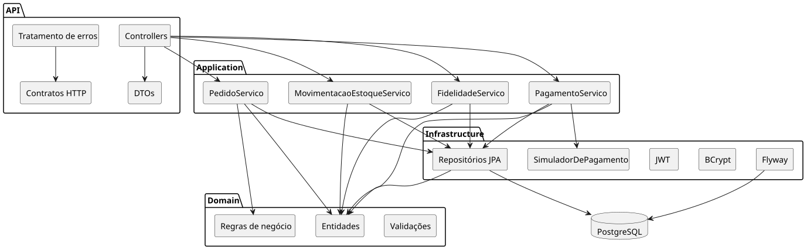
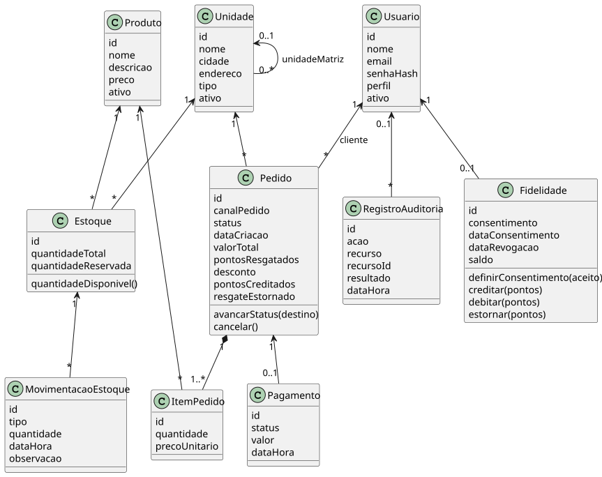
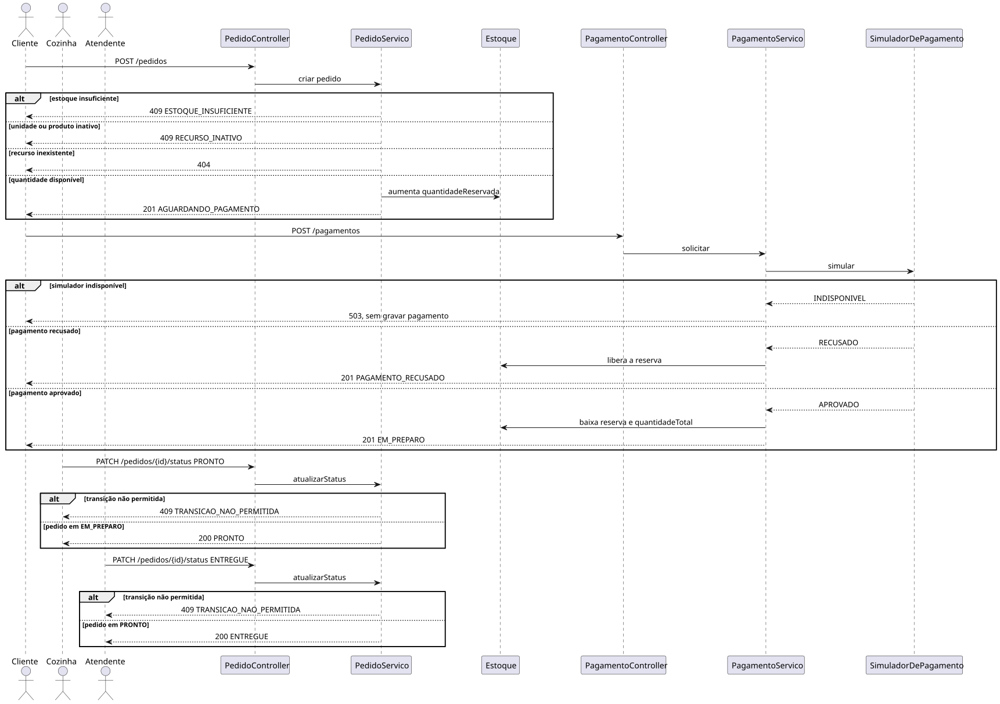

# Diagramas

Os desenhos desta pasta representam a API como ela está implementada. A fonte editável de cada um é o arquivo PlantUML

## Casos de uso

Cliente, Atendente, Cozinha e Gerente/administrador usam os casos que o respectivo perfil pode executar. O canal do pedido é o campo `canalPedido`, não um ator separado. O sistema externo de pagamento aparece porque o roteiro o pede: na API, essa simulação acontece dentro de `SimuladorDePagamento`.

## Realizar pedido e solicitar pagamento

A funcionalidade crítica leva um pedido do carrinho até a entrega, com pagamento simulado.

**Pré-condições** O usuário está autenticado; a unidade e os produtos existem e estão ativos; Existe quantidade disponível, ou seja, estoque total menos o já reservado; o cliente só cria e paga o próprio pedido

**Fluxo principal**

1. O cliente, o atendente ou o gestor envia `POST /pedidos` com `canalPedido` e ao menos um item.
2. O pedido nasce em `AGUARDANDO_PAGAMENTO`. A criação aumenta `quantidadeReservada` e não baixa o estoque físico por enquanto
3. `POST /pagamentos` pede ao simulador o resultado `APROVADO`
4. A reserva é liberada, a quantidade total é baixada e o pedido passa a `EM_PREPARO`; o pagamento fica gravado, um por pedido
5. A cozinha envia `PATCH /pedidos/{id}/status` com `PRONTO`
6. O atendente envia o mesmo endpoint com `ENTREGUE`

**Pós-condições** O pedido está `ENTREGUE`, o pagamento está `APROVADO` e o estoque físico já foi reduzido na aprovação

**Exceções**

| Situação | Resposta |
| --- | --- |
| Unidade, cliente ou produto inexistente | 404 |
| Unidade ou produto inativo | 409 `RECURSO_INATIVO` |
| Quantidade acima do disponível | 409 `ESTOQUE_INSUFICIENTE` |
| Resultado simulado `RECUSADO` | 201, pedido `PAGAMENTO_RECUSADO`. A reserva volta e o estoque físico permanece |
| Simulador `INDISPONIVEL` | 503. Nenhum pagamento é gravado e o estoque não muda |
| Novo pagamento quando o pedido já saiu de `AGUARDANDO_PAGAMENTO` | 409 `PAGAMENTO_NAO_PERMITIDO` |
| Status fora da sequência | 409 `TRANSICAO_NAO_PERMITIDA` |

Uma segunda tentativa de pagamento é recusada porque o pedido já não está aguardando pagamento

O cancelamento é permitido em `AGUARDANDO_PAGAMENTO`, `EM_PREPARO` e `PRONTO`. Antes do pagamento, só a reserva é liberada, depois do pagamento, a quantidade física volta por uma entrada. Pedido entregue, já cancelado ou com pagamento recusado não cancela

A cozinha só pode informar `PRONTO`. O atendente só pode informar `ENTREGUE`.   O Gestor segue a mesma sequência; campo ausente ou quantidade menor que 1 responde 422.

## DER

O banco final tem dez tabelas. Não existe tabela `cliente`: o pedido aponta para `usuario`

Estoque é único por unidade e produto

Pagamento e fidelidade são um para um

A auditoria aceita usuário nulo, como no cadastro público.

## Arquitetura

A API recebe o HTTP e chama os serviços. Os serviços aplicam as regras do domínio e usam os repositórios. 

JWT, BCrypt, Flyway e o simulador de pagamento ficam na infraestrutura. 

O PostgreSQL está fora da aplicação.

## Classes

O diagrama mostra as entidades de domínio e os métodos que carregam regra: status do pedido, quantidade disponível e pontos. Os Controllers, DTOs e serviços ficam na arquitetura

## Sequência do pedido

Da criação à entrega, com estoque insuficiente, recurso inativo, recurso inexistente, recusa, indisponibilidade do simulador e transição de status inválida

