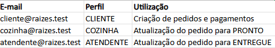
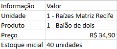
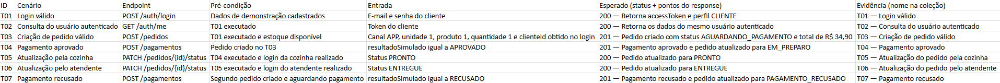
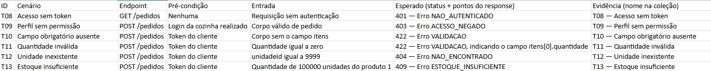

  # Plano de testes — Raízes do Nordeste
 
  Objetivo

Este documento apresenta os cenários de teste utilizados para validar o funcionamento da API do Raízes do Nordeste.

O principal objetivo é demonstrar o Fluxo A, que envolve a criação de um pedido, o processamento de um pagamento simulado e a atualização do status até a entrega.

Os testes podem ser executados pelo Postman, utilizando a coleção 'raizes-do-nordeste.postman_collection.json', disponível nesta mesma pasta.

O Fluxo A foi escolhido como o fluxo principal do projeto, pois contempla todas as etapas previstas e está implementado na API.

Além disso, o sistema possui algumas funcionalidades de controle de estoque que também serão demonstradas durante os testes.

  Escopo dos testes

A coleção contempla os seguintes pontos:

- Login e autenticação utilizando JWT.
- Consulta dos dados do usuário autenticado.
- Criação e consulta de pedidos.
- Atualização do status dos pedidos.
- Processamento de pagamentos simulados, tanto aprovados quanto recusados.
- Validações de acesso, campos obrigatórios e regras de negócio.
- Tratamento de situações como unidade inexistente e estoque insuficiente.

O projeto também possui algumas regras relacionadas ao controle de estoque:

- Ao criar um pedido, a quantidade solicitada fica reservada, mas ainda não é retirada do estoque total.
- Caso a quantidade solicitada seja maior que a disponível, o pedido não é criado e a API retorna 409 'ESTOQUE_INSUFICIENTE'.
- Quando o pagamento é aprovado, a reserva é liberada e a quantidade é descontada do estoque.
- Quando o pagamento é recusado, a reserva é liberada, mas o estoque físico permanece igual.
- Em situações de cancelamento permitidas, a quantidade reservada ou o estoque descontado é devolvido, dependendo do status do pedido.

Também existe a possibilidade de registrar entradas e saídas manualmente pelo endpoint 'POST /estoque/movimentacoes', disponível para os perfis ADMIN e GERENTE.

Apesar dessas funcionalidades, o Fluxo B não está completo. Atualmente, a API não possui operações próprias para cadastrar e consultar produtos, nem um endpoint específico para consultar o saldo de estoque por unidade.

A quantidade disponível pode ser consultada pelo cardápio, através de 'GET /unidades/{id}/cardapio', mas essa consulta não apresenta o saldo total e a quantidade reservada separadamente.

  Como executar os testes

Antes de executar a coleção, é necessário:

1. Iniciar o PostgreSQL utilizado pela aplicação.
2. Garantir que as migrations do Flyway tenham sido aplicadas, incluindo os dados de demonstração.
3. Configurar as variáveis `JWT_SECRET` e `JWT_EXPIRATION_SECONDS` no ambiente da aplicação. O segredo JWT deve possuir pelo menos 32 bytes.
4. Iniciar a API
5. Importar o arquivo 'raizes-do-nordeste.postman_collection.json' no Postman
6. Executar as requisições na ordem apresentada na coleção

Por padrão, a aplicação utiliza o endereço `http://localhost:8080`.

A coleção já possui algumas variáveis configuradas:

- 'baseUrl': endereço da API.
- 'senha': senha utilizada pelos usuários de demonstração.
- Tokens dos usuários: preenchidos automaticamente após os respectivos logins.
- 'clienteId': obtido através da resposta do login.
- Identificadores dos pedidos: armazenados durante a execução das requisições.

Não é necessário importar um ambiente separado. A própria coleção possui as variáveis necessárias.

Usuários de demonstração

Os usuários abaixo são criados pelas migrations do projeto e possuem a mesma senha: `Raizes@2026`.

Os logins da cozinha e do atendente são realizados antes dos testes que precisam desses perfis. Eles servem como preparação para as requisições e não entram na contagem dos cenários.

Dados utilizados nos pedidos

Os testes utilizam os dados inseridos pelas migrations:

O identificador do cliente não fica fixo na coleção. Ele é obtido automaticamente durante o login.

Ordem de execução

Os testes possuem algumas dependências entre si. Por isso, é importante executar as requisições na ordem indicada.

1. T01 — Login válido
2. Preparação — Login da cozinha
3. Preparação — Login do atendente
4. T02 — Consulta do usuário autenticado
5. T03 — Criação de pedido válido
6. Preparação — Criação de um segundo pedido para o teste de pagamento recusado
7. T04 — Pagamento aprovado
8. T07 — Pagamento recusado
9. T05 — Atualização do pedido pela cozinha
10. T06 — Atualização do pedido pelo atendente
11. T08 — Acesso sem token
12. T09 — Perfil sem permissão
13. T10 — Campo obrigatório ausente
14. T11 — Quantidade inválida
15. T12 — Unidade inexistente
16. T13 — Estoque insuficiente

O T02 utiliza o token obtido no T01. O T03 também depende do login do cliente, pois utiliza seu identificador para criar o pedido

O T04 utiliza o pedido criado no T03. Já o T07 utiliza um segundo pedido, criado exclusivamente para testar a recusa do pagamento

Os testes T05 e T06 dependem das etapas anteriores, pois o pedido precisa estar em 'EM_PREPARO' antes de avançar para 'PRONTO' e, posteriormente, `ENTREGUE`

Os demais cenários negativos utilizam o token do cliente, com exceção do T08, que deve ser executado sem autenticação

  Cenários de teste

Ao todo, foram definidos 13 cenários, sendo 7 positivos e 6 negativos.

  Cenários positivos

  Cenários negativos

O T07 é considerado um cenário positivo porque a API processa corretamente a simulação de recusa e retorna o resultado esperado. Não se trata de um erro HTTP.

A criação do segundo pedido para esse teste é apenas uma etapa de preparação, pois um pedido que já recebeu pagamento não pode ser utilizado novamente.

  Auditoria

O sistema também possui registros de auditoria para algumas operações importantes, como criação de pedidos, processamento de pagamentos e atualização de status.

Esses registros são armazenados na tabela 'registro_auditoria'.

Atualmente, não existe um endpoint para consultar esses registros diretamente pela API. Por esse motivo, a verificação da auditoria é realizada através dos testes automatizados e também pode ser conferida diretamente no banco de dados.

O teste 'AuditoriaTest', no método 'registraAcoesDoPedidoComOResponsavel', verifica os registros de criação do pedido, processamento do pagamento e atualização de status, incluindo o responsável por cada ação.

Também existem verificações para consultas de pedidos e dos próprios dados do usuário, no método 'registraConsultaDePedidosEDoProprioUsuario'.

Para conferir os registros diretamente no banco, pode ser utilizada a seguinte consulta:

SELECT acao, recurso, recurso_id, resultado
FROM registro_auditoria
ORDER BY id DESC;

Entre as ações esperadas estão:

- 'CRIAR_PEDIDO'
- 'PROCESSAR_PAGAMENTO'
- 'ATUALIZAR_STATUS_PEDIDO'

 Observações sobre novas execuções

É importante considerar que os testes alteram o estoque de demonstração.

Durante cada execução completa, o pagamento aprovado realiza a baixa de uma unidade do Baião de dois. Já o pagamento recusado apenas libera a reserva, sem descontar o estoque físico.

O estoque inicial cadastrado pelas migrations é de 40 unidades. Quando esse saldo acaba, a criação de novos pedidos pode retornar 409, impedindo a continuidade dos testes, portanto, deve ser considerado este ponto ao realizar os testes

Como as migrations do Flyway são executadas apenas na primeira aplicação, executar novamente a aplicação não restaura automaticamente os dados do seed

Portanto, antes de realizar uma nova execução completa, é necessário restaurar o saldo de demonstração no banco ou recriar o banco para que as migrations sejam aplicadas novamente

A coleção não realiza essa restauração automaticamente

Os testes também utilizam os identificadores de unidade e produto definidos no seed. Caso esses dados sejam alterados manualmente, será necessário conferir as variáveis e os corpos das requisições antes de executar a coleção novamente.